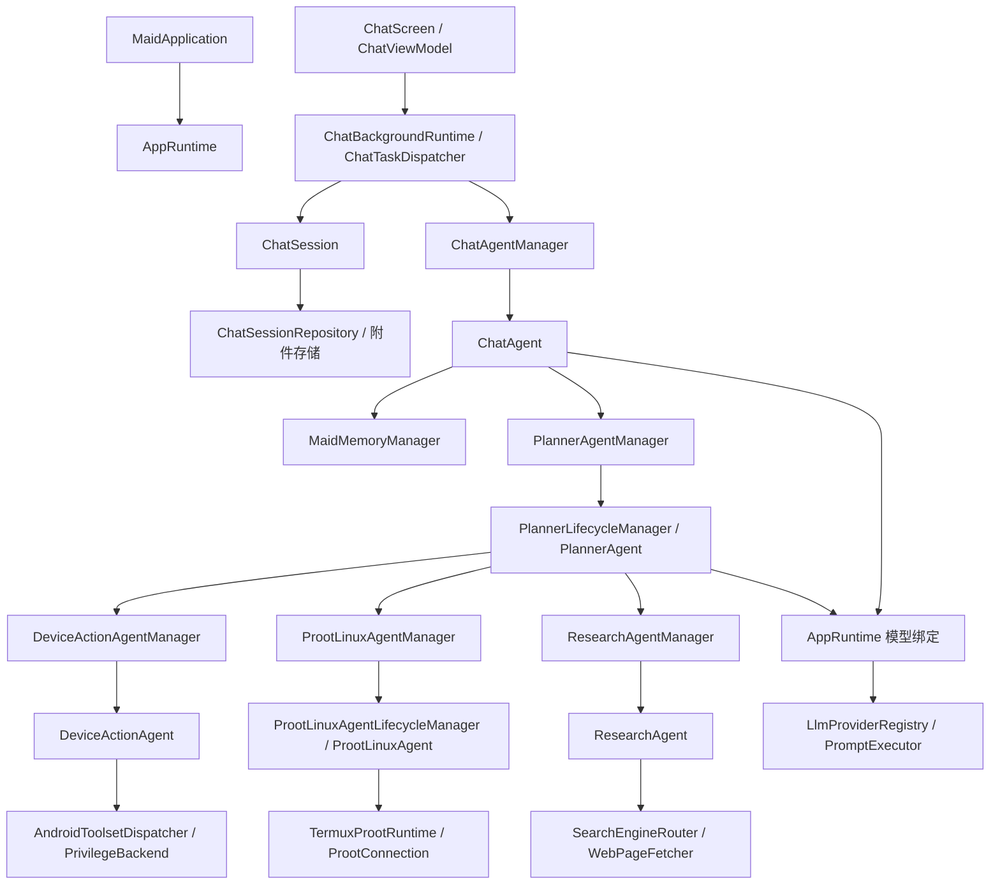

# 架构与代码导航

[返回 README](../README.md) · [开发指南](development.md)

本文描述当前代码的职责划分。包目录均相对于 `app/src/main/java/top/aaa000111/maid/`。

## 总体结构

图中展示主要调用方向，未展开全部视觉、授权与配置依赖。

## 启动与运行态

入口是 [MaidApplication.kt](../app/src/main/java/top/aaa000111/maid/MaidApplication.kt)。它调用 `AppRuntime.init`，刷新 Shizuku 状态，并在 IO 协程中同步模型执行器、TinyModel 与搜索配置。

[AppRuntime.kt](../app/src/main/java/top/aaa000111/maid/runtime/AppRuntime.kt) 是应用级运行态组合入口，负责仓储与管理器初始化、四角色模型绑定和缓存、端侧模型、搜索共享实例及资源释放。当前采用显式初始化、仓储单例与可注入依赖的组合方式；新功能应先沿用这些边界。

## MaidLang 脚本核心

`:app` 编入 [MaidLang 的 Kotlin 核心](../third_party/maidlang/README.md)，可在应用内解析脚本、解释 AST 或编译字节码（含 `BytecodeFile` 编解码）并在 VM 执行。应用级单例 [MaidLangNativeRegistry](../app/src/main/java/top/aaa000111/maid/runtime/MaidLangNativeRegistry.kt) 预注册内置 Android 工具集对应的原生函数（记录所属 `toolsetId` 与候选可用权限组）、维护权限组配置与 `external fun` 声明，并通过单次 `lexer` 扫描实现源码缺失工具集检查（`check`），可按需向 `Interpreter` 与 `VM` 提供隔离的 `NativeRegistry` 快照。

## 系统任务调度

- [AlarmScheduler](../app/src/main/java/top/aaa000111/maid/runtime/AlarmScheduler.kt) 按墙钟时间安排一次系统广播。调用方传入应用内已在 Manifest 注册的接收器、稳定 ID 和可选参数。同一接收器和 ID 可替换或取消，接收器可从 `EXTRA_ALARM_ID` 读取 ID。系统可能延迟投递，设备重启后需重新登记。接收器宜声明为不导出，耗时工作可交给 WorkManager。
- [WorkScheduler](../app/src/main/java/top/aaa000111/maid/runtime/WorkScheduler.kt) 按名称提交一次性或周期性 `WorkRequest`，也可观察或取消。调用方在请求中声明 Worker、参数和执行约束，重试由 Worker 返回结果配置，冲突策略由调用方选择。WorkManager 负责持久化和系统重调度，周期任务的最短间隔为 15 分钟。
- [MaidLangTaskStore](../app/src/main/java/top/aaa000111/maid/runtime/MaidLangTaskStore.kt) 负责编译 MaidLang 源码（自动补充未显式声明的内置原生函数 `external fun` 声明并校验权限）、以 `.mlbc` 字节码 + `.json` 元数据持久化到私有目录并返回 `taskId`，以及按 `taskId` 在权限过滤后的 MaidLang VM 中执行。
- [ScheduledTaskExecution.kt](../app/src/main/java/top/aaa000111/maid/runtime/ScheduledTaskExecution.kt) 提供统一的两种触发载荷（启动带提示词的新对话会话、按 `taskId` 执行已编译 MaidLang 脚本）、[ScheduledTaskExecutor](../app/src/main/java/top/aaa000111/maid/runtime/ScheduledTaskExecution.kt)、[ScheduledTaskWorker](../app/src/main/java/top/aaa000111/maid/runtime/ScheduledTaskExecution.kt) 与不导出的 [ScheduledAlarmReceiver](../app/src/main/java/top/aaa000111/maid/runtime/ScheduledTaskExecution.kt)（收到广播后立即移交 WorkManager 异步执行）。
- [ScheduledTaskToolSet](../app/src/main/java/top/aaa000111/maid/agent/ScheduledTaskToolSet.kt) 将 `makeTask`、内置声明/已编译任务查询以及 AlarmManager / WorkManager 定时调度与取消暴露为 Koog `@Tool`，挂载在 `ChatAgent` 与 `PlannerAgent`。

运行中的聊天仍由聊天调度器管理。

## 聊天与生命周期

| 入口 | 职责 |
| --- | --- |
| `MainActivity.kt` | 主界面入口 |
| `chat/ChatScreen.kt` | Compose 聊天界面 |
| `chat/ChatViewModel.kt` | 输入状态、当前会话选择与 UI 状态组合 |
| `chat/ChatBackgroundRuntime.kt` | 应用级任务调度器、会话列表和后台执行状态 |
| `chat/ChatSession.kt` | 单会话状态、上下文、消息及工具交互 |
| `chat/ChatSessionRepository.kt` | 会话快照与恢复 |
| `chat/ToolCallStatusTracker.kt` | 工具执行状态跟踪 |

一次输入由 ViewModel 提交给 `ChatTaskDispatcher`，后者通过 `ChatAgentManager` 运行 `ChatAgent`，将结果写回会话状态，UI 通过 Flow 观察变化。调度器拥有独立的作用域与线程池，不依赖某个 Activity 或 ViewModel 的存活；切换会话不应取消其他会话任务。

后台运行是进程内生命周期能力，不保证 Android 杀进程后未完成的任务自动续跑。持久化会话恢复与运行中协程恢复是不同的机制。

文件与图片通过 `SessionAttachmentStorage`、`UriFileTransfer` 等组件处理。会话存储变化需要同时考虑消息、模型历史、附件引用和恢复兼容性。

## Agent Manager 与调用生命周期

五类 Agent 的工具入口由对应 Manager 持有，统一继承实现 ToolSet 的 `AgentManager`。基类仅在内存中保存 `taskId → Deferred<String>`，具体 `@Tool` 提交闭包后返回 ID，等待工具按 ID 返回结果；不设额外控制器、全局生命周期登记或结果淘汰。内部同步业务 API 和聊天 UI 保留结构化结果及调用方协程语义。具体 API、实例边界和测试见 [Agent Manager 文档](agent_managers.md)。

## Agent 职责

| Agent / 管理器 | 职责与边界 |
| --- | --- |
| `ChatAgent` | 面向用户的对话入口，独占 Koog 长期对话记忆 |
| `PlannerAgent` / `PlannerLifecycleManager` | 复杂任务规划、检查点推进及规划生命周期笔记 |
| `DeviceActionAgent` | 调用 Android 工具并结合安全配置拦截敏感操作 |
| `ProotLinuxAgent` / `ProotLinuxAgentLifecycleManager` | Linux 任务、专用终端与文件 I/O 生命周期 |
| `ResearchAgent` | 分类检索、网页阅读和调研结果收集 |
| `VisionToolSet` / `DirectImageReadToolSet` | 独立视觉分析或直接图片输入 |

Planner、DeviceAction 与 ProotLinux 的模型绑定优先使用复杂规划角色，再回退到快速廉价角色。视觉流程会根据相关文本角色与视觉角色是否绑定相同模型，选择直接图片输入或独立视觉工具。

默认系统提示及固定指导片段位于 `app/src/main/resources/prompts/`，通过 `prompt/PromptResources.kt` 读取并缓存；动态模型、权限与会话内容仍由现有组装方法提供。编辑入口和验证方式见[固定提示词管理](prompts.md)。

调整 Agent 时要同时检查工具注册、最大步数、取消传播、状态输出和上下文归属。规划生命周期笔记不应被当成 ChatAgent 的长期记忆。

## Provider 与模型角色

[ModelConfig.kt](../app/src/main/java/top/aaa000111/maid/provider/ModelConfig.kt) 定义四种角色：

| 角色 | 用途 |
| --- | --- |
| `FAST_CHEAP` | 日常对话 |
| `COMPLEX_PLANNING` | 复杂规划与执行推理 |
| `FAST_VISION` | 快速视觉处理 |
| `COMPLEX_VISION` | 复杂任务视觉处理 |

`LlmProvider` 描述服务商及鉴权方式；`LlmProviderRegistry` 处理可用性、执行器创建和模型适配；`ModelConfigRepository` 保存角色选择。API Key 管理列表与模型选择列表不相同，ChatGPT OAuth 不属于 API Key 服务商。

`AppRuntime.resolveModelBinding` 按候选角色解析配置并检查服务商可用性，缓存键关联服务商、自定义端点及模型。凭据失效时需要淘汰对应缓存，不能只更新设置界面。

`ChatGptAuth.kt` 与 `ChatGptResponsesPromptExecutor.kt` 分别处理 ChatGPT 登录会话和 Responses 请求执行。新增服务商时参考[接入指南](llm_provider.md)，并检查现有协议解析测试。

## Android 工具与权限

代码位于 `androidtool/`、`shizuku/` 与 `accessibility/`。

- `AndroidToolSet.requiredPrivileges` 声明支持的权限集合：默认满足其中任意一项即可；空集合表示无需特殊权限。
- `DefaultAndroidToolSets` 注册内置工具集，覆盖输入、按键、音量、手机系统闹钟（`AlarmClockToolSet`，基于 Android `AlarmClock` Intent）、屏幕、Shell、应用、窗口、Root 系统、设备策略、文件、使用情况与系统设置。
- `AlarmClockToolSet` 同时独立挂载到 `ChatAgent` 与 `PlannerAgent`，供直接调用手机自带时钟应用设置闹钟/倒计时、查看列表及关闭/延后响铃闹钟。
- `AndroidToolsetDispatcher` 按权限分发工具，具体执行通过现有后端处理。
- `ToolsetPermissionToolSet` 与会话授权流程配合；工具集可注册不意味着其中每种操作都具备相同后端能力。
- Shizuku 的 Binder 与 UserService 细节见 [Shizuku 文档](shizuku.md)。

新增工具应继续走权限声明、动态注册与执行时校验，避免在 UI 或模型提示词中代替真实权限检查。

[VirtualDisplayManager](../app/src/main/java/top/aaa000111/maid/display/VirtualDisplayManager.kt) 管理使用指定 Surface 的虚拟显示器。无头浏览器复用其私有显示器。Planner 可委托 [VirtualDisplayAgentManager](../app/src/main/java/top/aaa000111/maid/agent/VirtualDisplayAgentManager.kt)，它在创建前检查 Shizuku 授权与后端能力，并按显示器 ID 提交和等待任务。Shizuku UserService 使用 Maid 提供的 Surface 创建并持有受信任的 Agent 显示器。显示器承载独立内容并可被系统枚举，Shizuku 按绑定 ID 读取 UI 树。释放租约或 Maid 进程退出时，UserService 释放显示器。截图分析使用快速视觉模型，输入和观察均绑定到同一显示器。

## PRoot、终端与端侧模型

`TermuxProotRuntime` 管理应用私有目录中的单一 rootfs。初始化源优先使用用户导入归档，其次是内置归档；无可用归档时可生成最小目录骨架，但骨架不代表完整可运行发行版。

`ProotConnection` 封装进程与终端连接，`ProotVtfxTerminalManager` 连接终端渲染。原生构建位于 `app/src/main/cpp/CMakeLists.txt`；`third_party/vtfx/src/main/kotlin` 通过 app 的 source set 直接参与编译。

Linux Agent 建议使用 `/root/<session id>/` 工作目录，但代码明确允许共享和修改 rootfs，不提供会话级强隔离。重置 rootfs 前会通知相关连接释放。

`tinymodel/` 负责模型发现、导入、配置、LiteRT-LM 推理与执行器适配。内置模型先解包到私有目录再交给原生引擎；后端区分 AUTO、GPU 与 CPU。部分模型启用了每次 Conversation 重建 Engine 的隔离策略，不要在未验证状态串扰前移除。

`TinyModelLocalBridge` 提供仅监听 `127.0.0.1` 的本地 HTTP 桥接；`ProotLlmApiEnv` 则处理 Linux 任务的模型环境配置。这些连接涉及凭据和进程生命周期，修改时避免把环境变量中的秘密写入日志。

## 搜索

`SearchEngineRouter` 按搜索分类组织引擎，负责可用性探测、同分类回退、多引擎聚合与去重。`WebPageFetcher` 使用 Ksoup 提取正文，`SearchResultFilter` 提供规则或 TinyModel 过滤。`ProotSearXngManager` 管理本地 PRoot 中的 SearXNG 服务。

新增搜索引擎应遵守分类边界，保留取消传播，并为网络解析与回退行为使用 fake HTTP 测试。

## 技能与执行证据

`learning/` 通过协程上下文贯穿后台任务与工具执行，独立记录父子任务、规划里程碑和加载的技能版本；任务正常返回与结果验证状态分别保存。

`skill/` 提供不可变技能包、活动版本索引、描述检索和只读加载工具。任务开始固定目录快照，子任务继承版本；模型没有技能写入接口。详细数据流、限制和测试见[技能与执行证据](skills.md)。

## 数据位置

以下路径均在应用私有目录中，以实际配置和仓储实现为准：

| 数据 | 默认位置或组件 |
| --- | --- |
| 会话快照 | `filesDir/maid_sessions/`，会话文件位于其 `sessions/` 子目录 |
| 长期记忆 | `filesDir/koog_memory/` |
| Linux 文件系统 | `filesDir/rootfs/` |
| 自定义初始化归档 | `filesDir/rootfs_init/` |
| 解包或导入的端侧模型 | `filesDir/tiny_models/` |
| 已编译 MaidLang 任务 | `filesDir/maidlang_tasks/`（`.mlbc` 与 `.json`） |
| API Key 与 OAuth 敏感数据 | `SecureKeyStorage`，Tink AES256_GCM 加密后存入 DataStore |

聊天历史、附件和 rootfs 不因此自动获得凭据存储相同的加密保护。模型请求、搜索与设备工具的数据流需要分别评估。
